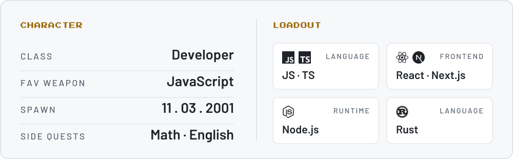
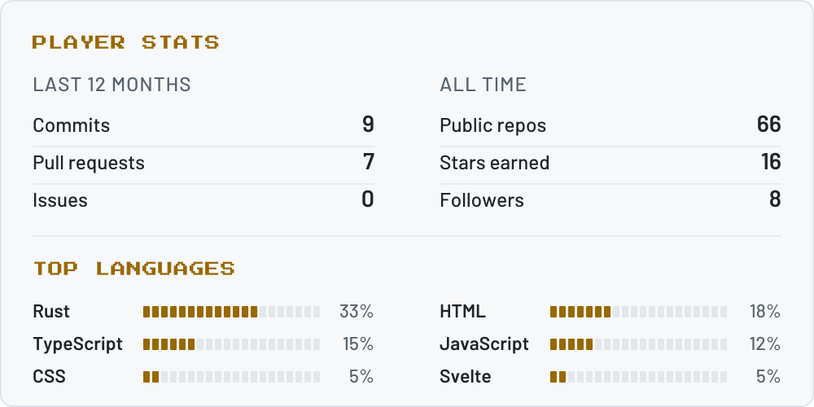
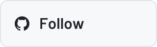
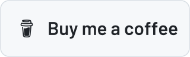

  <picture><source media="(prefers-color-scheme: dark)" srcset="https://raw.githubusercontent.com/wik1ngst-1103/wik1ngst-1103/main/assets/header-dark.svg" /></picture>

  <picture><source media="(prefers-color-scheme: dark)" srcset="https://raw.githubusercontent.com/wik1ngst-1103/wik1ngst-1103/main/assets/sheet-dark.svg" /></picture>

  <picture><source media="(prefers-color-scheme: dark)" srcset="https://raw.githubusercontent.com/wik1ngst-1103/wik1ngst-1103/output/quests-dark.svg" /></picture>

  <picture><source media="(prefers-color-scheme: dark)" srcset="https://raw.githubusercontent.com/wik1ngst-1103/wik1ngst-1103/output/stats-dark.svg" /></picture>

  <picture><source media="(prefers-color-scheme: dark)" srcset="https://raw.githubusercontent.com/wik1ngst-1103/wik1ngst-1103/main/assets/title-contrib-dark.svg" /></picture>
  <picture><source media="(prefers-color-scheme: dark)" srcset="https://raw.githubusercontent.com/wik1ngst-1103/wik1ngst-1103/output/github-snake-dark.svg" /></picture>

  <a href="https://github.com/wik1ngst-1103"><picture><source media="(prefers-color-scheme: dark)" srcset="https://raw.githubusercontent.com/wik1ngst-1103/wik1ngst-1103/main/assets/link-github-dark.svg" /></picture></a>
  <a href="https://facebook.com/lethanhson.wist0514"><picture><source media="(prefers-color-scheme: dark)" srcset="https://raw.githubusercontent.com/wik1ngst-1103/wik1ngst-1103/main/assets/link-facebook-dark.svg" /></picture></a>
  <a href="https://www.buymeacoffee.com/thanhson0514"><picture><source media="(prefers-color-scheme: dark)" srcset="https://raw.githubusercontent.com/wik1ngst-1103/wik1ngst-1103/main/assets/link-coffee-dark.svg" /></picture></a>

